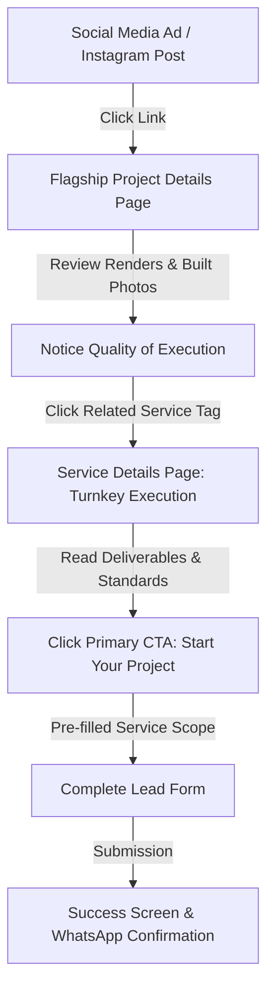
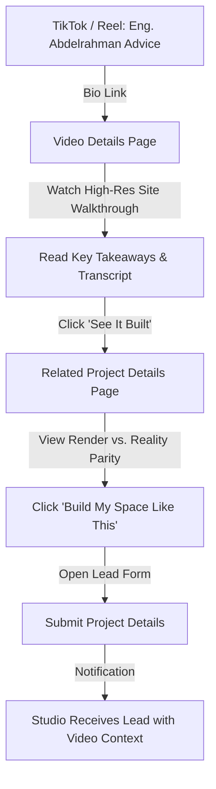
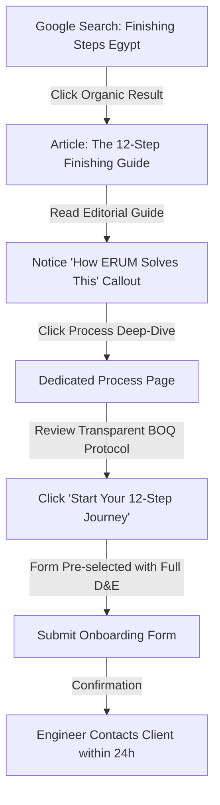
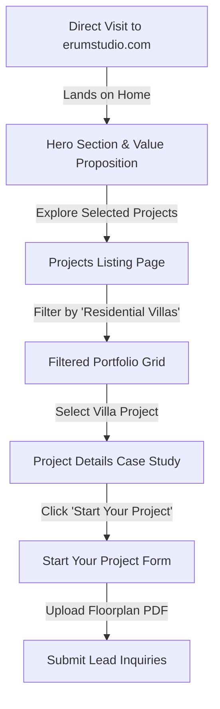
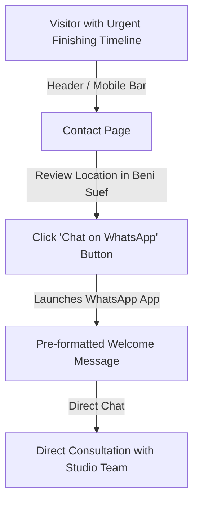

# ERUM Interior Studio — Wireframes & Page Structure Specification

> **Document Status:** Planning & Wireframing (Phase 2: Wireframing and Page Structure)  
> **Target Audience:** UX Designers, Information Architects, Copywriters, Frontend Engineers, and Client Stakeholders  
> **Classification Key:**  
> - `[CONFIRMED]`: Established in project requirements or client agreements.  
> - `[PROPOSED]`: UX/wireframe pattern proposed for client and team review.  
> - `[PENDING CLIENT CONFIRMATION]`: Open strategic or asset dependency awaiting client decision.

---

## 1. Executive Summary & Wireframing Methodology

This document defines the structural architecture, component hierarchies, layout behavior, and user journeys across all **19 discrete pages** of the **ERUM Interior Studio** digital platform.

### Core Architecture Philosophy
1. **Real Project Showcase Primacy:** The layout provides an editorial, uncluttered frame for genuine ERUM photography and site execution. Interface elements never compete with spatial imagery.
2. **Modular Content Ecosystem:** Every article, video explainer, and service detail acts as an on-ramp into related projects and lead-generation CTAs ("Start Your Project").
3. **Intentional Mobile-First Experience:** Built specifically for visitors arriving via social media campaigns (TikTok, Instagram, Facebook), ensuring immediate clarity, single-thumb navigation, zero horizontal scrolling, and instant WhatsApp consultation access.
4. **Native Bilingual Symmetry:** Complete structural, typographic, and directional parity across Arabic (RTL) and English (LTR) layouts without automatic or clumsy flipping.

---

## 2. Universal Page Framework

All pages share a standardized global frame:

```
┌────────────────────────────────────────────────────────────────────────┐
│ [TOP UTILITY BAR - Optional on Desktop: Working Hours | Direct Phone]  │
├────────────────────────────────────────────────────────────────────────┤
│ [BRAND LOGO]      [Projects  Services  About  Knowledge  Contact]      │
│                   [Language Switch: AR/EN]  [CTA: Start Your Project]   │
├────────────────────────────────────────────────────────────────────────┤
│                                                                        │
│                          PAGE CONTENT AREA                             │
│                                                                        │
├────────────────────────────────────────────────────────────────────────┤
│ [GLOBAL FOOTER]                                                        │
│ [Brand & Founder]  [Projects]  [Services]  [Knowledge]  [Contact/Map] │
│ [Bilingual Copyright © 2026]                     [Privacy] [Terms]     │
└────────────────────────────────────────────────────────────────────────┘
```

### Global Header Specifications
- **Desktop (≥ 1024px):** Fixed height (80px), transparent over hero or solid `#FFFFFF` on scroll (`backdrop-filter: blur(8px)`).
  - *Start:* Primary Brand Lockup (Monogram + Wordmark + "Interior Studio").
  - *Center:* Primary Navigation Links `[PROPOSED NAVIGATION]`:
    1. Projects
    2. Services
    3. About
    4. Knowledge
    5. Contact
  - *End:* Language Switcher (`AR` / `EN`) + High-contrast CTA Button ("Start Your Project").
  - *Navigation Placement Rationale:* In accordance with `docs/02_information_architecture.md`, top-level desktop navigation is limited to 5 primary destinations plus the CTA. *Process* and *Meet The Engineer* are featured within key page sections (Home, Services, About) and footer navigation rather than crowding the main header.
- **Mobile (< 1024px):** Sticky 64px bar.
  - *Start:* Compact brand mark (height 32px).
  - *End:* WhatsApp direct-action icon button (`44px × 44px` touch target) + Hamburger Menu Trigger (`48px × 48px`).
- **Mobile Menu Drawer:** Full-screen midnight navy (`#0E1B33`) surface. Accessible typographic links to all primary pages (Projects, Services, About, Knowledge, Contact, Process, Meet The Engineer), language toggle, phone, WhatsApp, and social media channels.

### Global Footer Specifications
- Deep midnight navy surface (`#0E1B33`) anchoring every page.
- 4-column structured layout on desktop; single-column stacked accordion on mobile.
- Persistent founder attribution: *"Eng. Abdelrahman Abdelrazek — Interior Design & Execution Engineer"*.
- Verified contact channels: Phone, WhatsApp, physical studio address in Beni Suef, and operating hours.

---

## 3. Responsive Wireframe Principles

| Viewport | Grid Architecture | Margin & Gutter | Core Layout Behavior |
| :--- | :--- | :--- | :--- |
| **Mobile (`< 640px`)** | 4 columns | `16px` margin, `16px` gutter | Single-column stack. Full-width cards. Sticky bottom CTA or quick WhatsApp bar. Thumb-friendly navigation. Zero horizontal overflow. |
| **Tablet (`640px–1023px`)** | 8 columns | `24px` margin, `24px` gutter | 2-column card grids. Side-by-side metadata and form layouts. Horizontal scroll chips for categories. |
| **Desktop (`1024px–1439px`)**| 12 columns | `32px` margin, `32px` gutter | 3-column project matrices. Asymmetric editorial splits (7/5 or 8/4). Spacious section padding (80–120px). |
| **Wide (`1440px+`)** | 12 columns | Centered container (`max-width: 1440px`) | Max container constraints prevent extreme line lengths; expansive photo galleries. |

---

## 4. Comprehensive 19-Page Wireframe Specifications

---

### Page 1: Home

* **Page Objective:** Immediately communicate ERUM's unique triad model (Design Studio + Execution Company + Project Management), showcase hero project quality, build engineering credibility, and direct visitors to portfolio exploration or project consultation.
* **Target Visitor Intent:** Discovers ERUM via social media ad, recommendation, or search; wants to quickly evaluate design taste, execution capability, and working reliability.
* **Section Order:**
  1. Header (Global)
  2. Hero Section
  3. Selected Projects Showcase
  4. Core Triad Positioning ("What ERUM Does")
  5. Design → Execution → Reality Proof Section
  6. The 12-Step ERUM Process Overview
  7. Featured Knowledge & Video Hub
  8. Meet The Engineer (Eng. Abdelrahman Abdelrazek)
  9. Client Testimonials & Endorsements
  10. Final Call to Action
  11. Footer (Global)
* **Section Purpose & Required Content:**
  * *Hero:* Single cinematic hero project image or slow ambient video reel, primary value headline (*"Architectural Design · Turnkey Execution · Project Delivery"* `[PROPOSED MARKETING HEADLINE]`), sub-headline clarifying scope in Beni Suef and Egypt `[PROPOSED - PENDING CLIENT CONFIRMATION OF SCOPE]`, dual CTAs ("Explore Selected Projects" and "Start Your Project").
  * *Selected Projects:* 3–4 flagship real projects highlighting diverse categories (Residential Villa, Commercial, Administrative), project metadata chips (Location, Area m², Scope).
  * *Core Triad:* 3 distinct visual cards articulating Interior Design (3D space planning), Turnkey Execution (craftsmanship, materials), and Project Management (BOQ, timelines).
  * *Design to Reality:* Interactive or side-by-side comparison illustrating a 3D visualization alongside the finished space photography.
  * *Process Preview:* Linear milestone strip condensing the 12-step journey into 4 digestible phases (Consultation → Design → Execution → Handover).
  * *Featured Knowledge:* 1 featured video explainer + 2 high-impact articles addressing common finishing pitfalls.
  * *Meet The Engineer:* Authentic portrait of Eng. Abdelrahman, short engineering bio, philosophy quote, and direct link to full profile.
  * *Testimonials:* Sample quote placeholders only; real quotes from verified property owners citing project experience `[PENDING CLIENT CONFIRMATION AND CLIENT PERMISSION]`.
  * *Final CTA:* Full-width midnight navy banner driving consultation inquiries.
* **Proposed Components:** `HeroBanner`, `ProjectGridCard`, `TriadFeatureCard`, `RenderVsRealityWidget`, `ProcessTimeline`, `ContentCard`, `EngineerBioCard`, `TestimonialCarousel`, `CtaBanner`.
* **Primary & Secondary CTAs:**
  * *Primary:* "Start Your Project" (Direct to lead form).
  * *Secondary:* "Explore All Projects" (Direct to Projects Listing).
* **Required Assets:**
  - 1 High-resolution hero project photograph or cinematic ambient reel.
  - 3–4 Flagship completed project photo sets.
  - 1 Pair of verified 3D Render vs. Real Photography for the comparison widget.
  - Authentic site/studio portrait of Eng. Abdelrahman.
  - Verified client testimonial quotes and project references.
* **Dynamic vs. Static Content:** Dynamic (Selected Projects, Featured Knowledge, Testimonials fetched via CMS); Static (Hero messaging, Triad architecture, Process overview).
* **Responsive Considerations:** Hero text scales fluids (`clamp(2rem, 5vw, 3.5rem)`); Render vs. Reality widget switches from split-screen drag on desktop to tap-to-toggle or swipe on mobile.
* **RTL/LTR Considerations:** Timeline direction mirrors (flows right-to-left in Arabic); project metadata badges anchor to the inline start edge.
* **Accessibility Considerations:** Video background (if used) must include a pause button and `prefers-reduced-motion` static image fallback; contrast ratios meet WCAG AA.
* **SEO Considerations:** `H1`: "ERUM Interior Studio — Interior Design, Turnkey Execution & Project Management in Egypt"; schema markup `Organization` + `LocalBusiness`.
* **Dependencies & Open Questions:**
  - `[PENDING CLIENT CONFIRMATION]`: Confirmation of top 3 flagship projects.
  - `[PENDING CLIENT CONFIRMATION]`: Verified client testimonial permissions.

---

### Page 2: About ERUM

* **Page Objective:** Establish company legitimacy, explain ERUM’s founding ethos, communicate design and execution standards, and differentiate the studio from unorganized finishing crews.
* **Target Visitor Intent:** Qualified lead or commercial client conducting due diligence on the studio’s background, values, and engineering leadership before committing to a contract.
* **Section Order:**
  1. Header
  2. Page Title & Editorial Manifesto
  3. The ERUM Story & Founding Vision
  4. Core Values & Execution Philosophy (Precision, Transparency, Material Integrity)
  5. Areas Served & Operational Reach (Beni Suef `[CONFIRMED]`; Greater Cairo & Regional Egypt `[PENDING CLIENT CONFIRMATION]`)
  6. Studio & Site Craftsmanship Gallery
  7. Team & Craftspeople Culture
  8. Lead CTA
  9. Footer
* **Section Purpose & Required Content:**
  * *Manifesto:* Narrative statement addressing the gap between architectural design and contractor execution `[PROPOSED DRAFT]`.
  * *Founding Story:* Genesis of the studio, bringing engineering discipline to interior finishing `[PROPOSED - PENDING CLIENT CONFIRMATION OF COMPANY HISTORY]`.
  * *Values:* 3–4 pillar cards detailing realistic BOQs, transparent costing, material verification, and scheduled milestone sign-offs.
  * *Craftsmanship Gallery:* 4–6 authentic photos of on-site joinery, gypsum framing, electrical cabling, and stone installation.
* **Proposed Components:** `PageHeader`, `NarrativeBlock`, `ValuePillarCard`, `PhotoGridGallery`, `RegionalCoverageMap`, `CtaBanner`.
* **Primary & Secondary CTAs:**
  * *Primary:* "Discuss Your Space" (Direct to Start Your Project).
  * *Secondary:* "Meet Engineer Abdelrahman" (Direct to Meet The Engineer).
* **Required Assets:** Studio narrative copy, 6+ authentic site craftsmanship photos, geographic coverage list.
* **Dynamic vs. Static Content:** Primarily static; easily editable via CMS.
* **Responsive Considerations:** 2-column narrative collapses to comfortable single-column reading on tablet and mobile (`container.md`).
* **RTL/LTR Considerations:** Layout symmetry preserved; quotes mirrored with correct typographical quotation marks (`« ... »` for Arabic).
* **Accessibility Considerations:** All craftsmanship gallery images require descriptive alt text detailing the specific construction trade shown.
* **SEO Considerations:** `H1`: "About ERUM Interior Studio — Architecture, Execution & Turnkey Finishing";
* **Dependencies & Open Questions:**
  - `[PENDING CLIENT CONFIRMATION]`: Official company founding year, legal entity name, and full company biography.

---

### Page 3: Meet The Engineer (Eng. Abdelrahman Abdelrazek)

* **Page Objective:** Position Engineer Abdelrahman as a trusted personal brand, master architect, and authoritative mentor in interior design and execution.
* **Target Visitor Intent:** Visitor has seen Eng. Abdelrahman on TikTok/Instagram or wants to know the credentials and personality of the engineer who will oversee their property.
* **Section Order:**
  1. Header
  2. Profile Header (Editorial Portrait + Name + Official Title)
  3. Personal Mission & Engineering Philosophy
  4. Academic Credentials & Practical Experience
  5. Featured Video Advice (Curated clips of the engineer explaining concepts)
  6. Selected Projects Personally Directed
  7. Personal Social Channels (TikTok, Instagram, YouTube, Facebook)
  8. Direct Consultation CTA
  9. Footer
* **Section Purpose & Required Content:**
  * *Profile Header:* High-resolution portrait, full Arabic name (م. عبد الرحمن عبد الرازق), English name (Eng. Abdelrahman Abdelrazek), official title.
  * *Philosophy:* Personal commitment to honesty in finishing, protecting client investments, and architectural innovation.
  * *Credentials:* Verified architectural/engineering degree, certifications, and practical site supervision experience `[PENDING CLIENT CONFIRMATION - Do not invent academic degrees or credentials]`.
  * *Video Advice:* 2–3 hand-picked short-form or long-form videos showing the engineer explaining materials on site.
  * *Selected Projects:* 2 project cards personally highlighted by the founder.
* **Proposed Components:** `FounderHero`, `CredentialBadgeGrid`, `VideoEmbedCard`, `ProjectGridCard`, `SocialChannelLinks`, `CtaBanner`.
* **Primary & Secondary CTAs:**
  * *Primary:* "Book a Consultation with Eng. Abdelrahman".
  * *Secondary:* "Watch Engineer's Advice Videos".
* **Required Assets:**
  - High-resolution professional portrait of Eng. Abdelrahman.
  - 2–3 on-site candid photos (reviewing drawings, inspecting finishes).
  - Official biography text, education, and credentials list.
* **Dynamic vs. Static Content:** Hybrid; biography is static, highlighted videos and projects dynamically link from CMS.
* **Responsive Considerations:** On mobile, portrait stacks above title and bio with circular or softened rectangular framing; social channel buttons format as accessible touch cards.
* **RTL/LTR Considerations:** Bio and credentials align to start edge; social icons remain recognizable universal glyphs.
* **Accessibility Considerations:** Portrait image alt text: `Eng. Abdelrahman Abdelrazek on-site inspecting interior architectural finishes`.
* **SEO Considerations:** `H1`: "Eng. Abdelrahman Abdelrazek — Interior Design & Execution Engineer"; schema markup `Person` with `sameAs` links to social media profiles.
* **Dependencies & Open Questions:**
  - `[PENDING CLIENT CONFIRMATION]`: Official English and Arabic titles, verified education, and bio sign-off (`docs/05_open_questions.md#engineer`).

---

### Page 4: Services Listing

* **Page Objective:** Present the full breadth of ERUM’s capabilities, clarify service bundles, and guide visitors toward the exact engagement model that fits their project.
* **Target Visitor Intent:** Property owner exploring what services ERUM offers (e.g., "Do they only do 3D design, or can they execute everything turnkey?").
* **Section Order:**
  1. Header
  2. Page Header & Scope Overview
  3. Interactive Service Category Grid
  4. Service Bundles (Design Only vs. Full Turnkey Design + Execution)
  5. Quality & Supervision Standards `[PROPOSED FRAMEWORK - PENDING CLIENT CONFIRMATION]`
  6. Service FAQ Accordion
  7. Service Inquiry CTA
  8. Footer
* **Section Purpose & Required Content:**
  * *Service Grid:* Comprehensive cards for the 5 confirmed/proposed service pillars:
    1. Interior Design (3D Concept, Spatial Layout, Moodboards)
    2. Turnkey Execution (Civil, Electrical, Plumbing, Finishing)
    3. Project Management & Site Supervision (BOQ, Procurement, QA)
    4. Custom Furniture & Woodwork (Bespoke Joinery, Millwork)
    5. Exterior & Architectural Facade Design
  * *Deliverables Matrix:* Clear bullet points for each service explaining what the client receives upon completion.
  * *FAQ:* Addressing common questions regarding payment schedules, site visit locations, and material procurement.
* **Proposed Components:** `PageHeader`, `ServiceCategoryCard`, `DeliverablePill`, `ComparisonMatrix`, `AccordionGroup`, `CtaBanner`.
* **Primary & Secondary CTAs:**
  * *Primary:* "Request a Service Proposal".
  * *Secondary:* "View Related Projects" (Deep link to pre-filtered portfolio).
* **Required Assets:** 5 representative high-res imagery vignettes (one for each service discipline), detailed deliverable lists.
* **Dynamic vs. Static Content:** Dynamic listing fetched from CMS `services` collection.
* **Responsive Considerations:** Desktop 3-column / 2-column split grid collapses to full-width stacked cards on mobile; deliverables chips wrap cleanly without horizontal truncation.
* **RTL/LTR Considerations:** Service card index numbers (`01`, `02`, `03`) anchor to the inline-start edge.
* **Accessibility Considerations:** Accordion controls implement proper `aria-expanded` and `aria-controls` attributes.
* **SEO Considerations:** `H1`: "Interior Design, Execution & Project Management Services — ERUM"; schema `Service` collection.
* **Dependencies & Open Questions:**
  - `[PENDING CLIENT CONFIRMATION]`: Final confirmation of service groups and deliverables (`docs/04_asset_checklist.md#services`).

---

### Page 5: Service Details (Template)

* **Page Objective:** Provide an in-depth breakdown of a single service discipline, demonstrate past proof of execution, explain deliverables, and convert the visitor into an inquiry.
* **Target Visitor Intent:** Client seeking a specific solution (e.g., "Turnkey Residential Execution" or "Custom Furniture") wanting to understand scope, workflow, and pricing parameters.
* **Section Order:**
  1. Header & Breadcrumb Trail (`Home > Services > Interior Design`)
  2. Service Hero (Title, Subtitle, Direct Action CTA)
  3. Service Scope & Detailed Overview
  4. Tangible Deliverables List (What you receive)
  5. Step-by-Step Execution Workflow for this Service
  6. Selected Projects Executed Under This Service
  7. Related Knowledge Hub Articles & Videos
  8. Service-Specific FAQs
  9. Contextual Consultation CTA (Pre-selected service tag)
  10. Footer
* **Section Purpose & Required Content:**
  * *Hero:* Architectural service header with background visual context.
  * *Deliverables List:* Checkmarked breakdown (e.g., "Executive Architectural Drawings, 3D Renders, Accurate BOQ, Lighting Layout, Material Schedules").
  * *Projects Showcase:* Filtered dynamic query showing the top 3 projects completed using this service.
  * *Knowledge Integration:* 2 educational articles or videos directly addressing this service (e.g., "How to review an interior design BOQ").
* **Proposed Components:** `Breadcrumb`, `ServiceDetailHero`, `DeliverableChecklist`, `WorkflowStepList`, `ProjectGridCard`, `ContentCard`, `ContextualLeadCta`.
* **Primary & Secondary CTAs:**
  * *Primary:* "Inquire About This Service" (Opens Start Your Project with pre-selected service value).
  * *Secondary:* "Speak via WhatsApp".
* **Required Assets:** 3+ verified project relationships, deliverable specifications per service, 1 feature banner image.
* **Dynamic vs. Static Content:** Dynamic CMS template populated by service slug.
* **Responsive Considerations:** Deliverables checklist displays as 2 columns on tablet/desktop, 1 column on mobile.
* **RTL/LTR Considerations:** Breadcrumbs flow in reading direction (`الرئيسية ← الخدمات ← التصميم الداخلي`).
* **Accessibility Considerations:** Screen readers announce breadcrumb navigation via `<nav aria-label="Breadcrumb">`.
* **SEO Considerations:** Dynamic `H1`: `[Service Name] in Egypt — ERUM Interior Studio`; schema `Service` with `provider`.
* **Dependencies & Open Questions:**
  - `[PROPOSED]`: Pre-selecting the service in the lead generation form when referred from this page.

---

### Page 6: Projects Listing (Portfolio)

* **Page Objective:** Provide an expansive, filterable showcase of completed and ongoing ERUM architectural and interior projects.
* **Target Visitor Intent:** Visitor wants to browse ERUM’s design style, project types, locations, and proof of quality before making contact.
* **Section Order:**
  1. Header
  2. Portfolio Title & Filter Bar (Type, Location, Service, Status)
  3. Featured Flagship Project Hero (Optional highlight)
  4. Dynamic Project Card Grid (Residential, Commercial, Administrative)
  5. Interactive "Render vs. Reality" Filter Toggle
  6. Pagination / "Load More Projects" Control
  7. Portfolio Inquiries CTA
  8. Footer
* **Section Purpose & Required Content:**
  * *Filter Bar:* Clean horizontal filter tags allowing instant client filtering:
    - *By Type:* All, Residential (Villas, Duplexes, Apartments), Commercial (Retail, Cafes, Restaurants), Administrative (Offices, Clinics).
    - *By Scope:* Full Turnkey, Design Only, Execution Only.
    - *Special Toggle:* "Render vs. Reality Only".
  * *Project Cards:* Comprehensive cards with photo, title, location, area in m², service badges, and direct link.
* **Proposed Components:** `PageHeader`, `FilterTagGroup`, `FeaturedProjectBanner`, `ProjectGridCard`, `PaginationControl`, `CtaBanner`.
* **Primary & Secondary CTAs:**
  * *Primary:* "Start Your Project Like These".
  * *Secondary:* Filter button clicks (Instant client-side filter updates).
* **Required Assets:** Minimum 10–15 approved projects with high-res photos and confirmed metadata (`docs/04_asset_checklist.md#projects`).
* **Dynamic vs. Static Content:** Fully dynamic CMS query with live filtering.
* **Responsive Considerations:** Filter bar scrolls horizontally with smooth snap points on mobile (`overflow-x: auto; scrollbar-width: none;`); card grid shifts from 3 columns (desktop) to 2 (tablet) to 1 (mobile).
* **RTL/LTR Considerations:** Filter chips start at inline-start; card badge positions mirror cleanly.
* **Accessibility Considerations:** Filter buttons maintain `aria-pressed="true|false"`; live region announces updated project counts (`aria-live="polite"`).
* **SEO Considerations:** `H1`: "Interior Design & Turnkey Projects Portfolio — ERUM"; filterable canonical architecture.
* **Dependencies & Open Questions:**
  - `[PENDING CLIENT CONFIRMATION]`: Permissions to publish photos and locations of initial 10–15 projects.

---

### Page 7: Project Details (Modular Case Study Template)

* **Page Objective:** Present an exhaustive, transparent, and beautiful narrative case study for a single project, highlighting design concepts, site execution, material selections, and before/after transformations.
* **Target Visitor Intent:** Client wants to see proof of execution, material quality, and spatial problem-solving on a real space similar to their own property.
* **Section Order (Modular Template):**
  1. Header & Breadcrumbs (`Home > Projects > Villa Al-Noor`)
  2. Project Hero & Title Block (Hero photo, Project Name, Location, Area m², Year, Status)
  3. Key Project Specs Bar (Category, Service Scope, Duration, Execution Year)
  4. Design Concept & Spatial Challenge (The Client Brief & Architectural Concept)
  5. 3D Render Gallery (The Visual Plan)
  6. On-Site Construction & Execution Gallery (The Engineering Reality)
  7. Final Built Photography (The Handover Result)
  8. Before & After Transformation Slider *(Optional - only appears if content exists)*
  9. Render vs. Reality Comparison Showcase *(Optional - only appears if content exists)*
  10. Architectural Floor Plans & Layout Diagrams *(Optional - only appears if client permits)*
  11. Project Walkthrough Video *(Optional - only appears if video exists)*
  12. Related Services Utilized
  13. Related Projects (Same type or location)
  14. Contextual Project CTA ("Build a Space Like This")
  15. Footer
* **Section Purpose & Required Content:** Detailed in [Section 5.2](#deep-dive-b-modular-project-details-template-dynamic-display-logic).
* **Proposed Components:** `ProjectHeroBanner`, `SpecBar`, `EditorialNarrative`, `GalleryLightbox`, `BeforeAfterSlider`, `RenderVsRealityWidget`, `FloorplanViewer`, `VideoPlayerEmbed`, `RelatedProjectSlider`, `ContextualLeadCta`.
* **Primary & Secondary CTAs:**
  * *Primary:* "Request a Consultation for a Similar Space".
  * *Secondary:* "Share Project" / "View Related Projects".
* **Required Assets:** 12–25 high-res photos per flagship project, categorized by phase (Render, Site, Final, Before/After).
* **Dynamic vs. Static Content:** Dynamic CMS case-study template with conditional section rendering.
* **Responsive Considerations:** High-resolution image galleries support pinch-to-zoom and full-screen swipe on mobile; spec bar wraps to 2-column grid on mobile.
* **RTL/LTR Considerations:** Spec bar labels and values align cleanly; directional slider handles mirror intuitively.
* **Accessibility Considerations:** All gallery images have accessible descriptions; slider handles include keyboard arrow control support (`aria-valuenow`).
* **SEO Considerations:** Dynamic `H1`: `[Project Name] — Interior Design & Execution in [Location]`; schema `VisualArtwork` or `CreativeWork`.
* **Dependencies & Open Questions:**
  - `[PENDING CLIENT CONFIRMATION]`: Availability of Before/After and Floorplan assets for initial batch of projects.

---

### Page 8: Process (Design → Execution → Reality)

* **Page Objective:** Demystify the entire interior design and execution journey, eliminating client anxiety regarding budgeting, quality control, and contractor chaos.
* **Target Visitor Intent:** Prospective client wanting to understand: "How does ERUM work? What are the exact steps? How do you ensure the budget doesn't double?"
* **Section Order:**
  1. Header
  2. Page Title & Process Philosophy ("The 12-Step ERUM Standard")
  3. Interactive 4-Phase Journey Navigator
  4. Phase 1: Discovery & Consultation (Steps 1–2: Consultation, Site Survey)
  5. Phase 2: Design & Planning (Steps 3–6: Space Planning, 3D Design, BOQ & Costing, Approvals)
  6. Phase 3: Procurement & Preparation (Steps 7–8: Timelines, Procurement, Material Selection)
  7. Phase 4: Execution & Handover (Steps 9–12: Site Works, QA Inspections, Final Polish, Handover)
  8. Quality Control & Transparency Protocol (Site visit logs, WhatsApp group updates)
  9. Process Video Walkthrough
  10. Process FAQs
  11. Start Your Project CTA
  12. Footer
* **Section Purpose & Required Content:**
  * *12-Step Detailed Breakdown:* Explicitly mirrors the confirmed requirements in `docs/01_requirements.md#process`.
  * *Phase Cards:* Each step explains: (a) What happens on site, (b) What the client receives, (c) Milestone approval required.
  * *Transparency Protocol:* Explaining how BOQs are calculated, how material changes are handled, and how engineering site supervision is scheduled.
* **Proposed Components:** `PageHeader`, `PhaseNavigator`, `TimelineStepCard`, `ProtocolBox`, `VideoEmbedCard`, `AccordionGroup`, `CtaBanner`.
* **Primary & Secondary CTAs:**
  * *Primary:* "Start Your 12-Step Journey".
  * *Secondary:* "Download Sample BOQ / Process Guide" *(Optional proposal)*.
* **Required Assets:** Authentic site inspection photography for each major phase, video walkthrough of Eng. Abdelrahman explaining the process.
* **Dynamic vs. Static Content:** Static structural content; easily maintained via CMS.
* **Responsive Considerations:** Desktop horizontal / zigzag timeline converts to a vertical step-by-step progress rail on mobile with sticky active phase indicators.
* **RTL/LTR Considerations:** Timeline progress rail anchors to the right in Arabic and the left in English.
* **Accessibility Considerations:** Steps structured using an ordered list `<ol>` with numbered milestone indicators for screen readers.
* **SEO Considerations:** `H1`: "Our 12-Step Interior Design & Execution Process — ERUM"; target keywords around "Interior Finishing Process Egypt".
* **Dependencies & Open Questions:**
  - `[CONFIRMED]`: The 12 steps are confirmed in `docs/01_requirements.md`. Content copy needs client sign-off.

---

### Page 9: Knowledge Hub (Central Editorial & Video Index)

* **Page Objective:** Act as ERUM’s content engine and authority platform, combining written finishing guides, video explainers, and Engineer's Advice into an organized learning hub.
* **Target Visitor Intent:** Visitor seeking trustworthy advice on finishing materials, space planning, budget allocation, or electrical/plumbing standards.
* **Section Order:**
  1. Header
  2. Knowledge Hub Header & Search Bar
  3. Content Category Pills (Interior Design, Finishing, Project Management, ERUM Process, Engineer's Advice)
  4. Featured Knowledge Story (Hero Editorial or Major Explainer Video)
  5. "Engineer's Advice" Video Carousel (Short-form tips & site walkthroughs)
  6. Latest Finishing Articles Grid
  7. Essential Finishing Guides (Curated high-value foundational guides)
  8. Direct Advice CTA ("Have a Specific Question?")
  9. Footer
* **Section Purpose & Required Content:**
  * *Search Bar:* Instant predictive search across articles, videos, and advice topics.
  * *Category Pills:* Quick-access navigation across 5 core educational tracks (`docs/03_content_hub.md`).
  * *Featured Story:* Prominently displays the most relevant seasonal or foundational piece of content.
  * *Engineer's Advice Carousel:* Highlights Eng. Abdelrahman’s direct video answers to client questions.
* **Proposed Components:** `PageHeader`, `SearchBar`, `FilterTagGroup`, `FeaturedContentHero`, `VideoCardCarousel`, `ArticleGridCard`, `ConsultationCta`.
* **Primary & Secondary CTAs:**
  * *Primary:* "Browse All Articles" / "Browse Video Library".
  * *Secondary:* "Ask Eng. Abdelrahman a Question" (Directs to Contact/Lead Form).
* **Required Assets:** Initial inventory of 5+ articles and 5+ videos (`docs/04_asset_checklist.md#priority-2--content--marketing`).
* **Dynamic vs. Static Content:** Fully dynamic CMS queries aggregating `articles` and `videos`.
* **Responsive Considerations:** Carousel supports native touch-scroll snapping on mobile; category pills allow smooth horizontal panning.
* **RTL/LTR Considerations:** Video play indicators and category chips mirror correctly; carousel scroll direction matches reading order.
* **Accessibility Considerations:** Search input has clear `<label>` and ARIA search role; video cards announce title and duration.
* **SEO Considerations:** `H1`: "Interior Design & Finishing Knowledge Hub — ERUM"; Hub & Spoke topic cluster SEO strategy.
* **Dependencies & Open Questions:**
  - `[PENDING CLIENT CONFIRMATION]`: Delivery of existing video inventory and article drafts (`docs/05_open_questions.md#content`).

---

### Page 10: Articles Listing

* **Page Objective:** Provide an editorial magazine-style repository of in-depth articles, material guides, and architectural design tips.
* **Target Visitor Intent:** Long-form reader searching for detailed technical or aesthetic guidance on finishing their home or commercial space.
* **Section Order:**
  1. Header & Breadcrumbs (`Home > Knowledge > Articles`)
  2. Articles Header & Topic Filter Tags
  3. Featured Article Banner
  4. Articles Grid (Paginated 3-column desktop / 1-column mobile)
  5. Newsletter / Social Advice Subscribe Box *(Optional proposal)*
  6. Footer
* **Section Purpose & Required Content:**
  * Filterable by topic: Interior Design Rules, Finishing & Utilities (Plumbing, Electrical, Gypsum), Costing & BOQ.
  * Card metadata: Cover image, Category chip, Reading time (e.g., "5 min read"), Title, Excerpt, Date.
* **Proposed Components:** `PageHeader`, `FilterTagGroup`, `FeaturedArticleCard`, `ArticleGridCard`, `PaginationControl`.
* **Primary & Secondary CTAs:**
  * *Primary:* "Read Article".
  * *Secondary:* "Start Your Project".
* **Required Assets:** Article cover photos (16:9), authored articles.
* **Dynamic vs. Static Content:** Fully dynamic CMS query.
* **Responsive Considerations:** 3-column desktop layout collapses to clean single-column cards on mobile.
* **RTL/LTR Considerations:** Reading time and category badge align to inline-start.
* **Accessibility Considerations:** Standard pagination with clear previous/next accessible labels.
* **SEO Considerations:** `H1`: "Interior Design & Finishing Guides — ERUM Articles"; Schema `CollectionPage`.
* **Dependencies & Open Questions:**
  - Initial volume of articles available at launch (`docs/04_asset_checklist.md`).

---

### Page 11: Article Details (Editorial Guide Template)

* **Page Objective:** Deliver high-value, SEO-optimized editorial content that educates the reader and seamlessly connects the topic to related ERUM services and projects.
* **Target Visitor Intent:** Visitor arrived via Google search or social link looking for a specific answer (e.g., "How to choose between porcelain and ceramic flooring in Egypt").
* **Section Order:**
  1. Header & Breadcrumbs (`Home > Knowledge > Articles > [Article Title]`)
  2. Article Header (Category, Title, Author: Eng. Abdelrahman, Date, Reading Time)
  3. Feature Image (16:9 high-res architectural capture)
  4. Quick Summary / Key Takeaways Box
  5. Article Body (Rich text, sub-headings H2/H3, inline project images, pull-quotes)
  6. Contextual Embedded Video Explainer *(If applicable)*
  7. "How ERUM Executes This" Callout Box (Connecting theory to real site practice)
  8. Related Project Showcase (Proving ERUM's real-world capability in this area)
  9. Author Bio Card (Eng. Abdelrahman Abdelrazek with portrait & credentials)
  10. Share Article (WhatsApp, Facebook, LinkedIn, Copy Link)
  11. Related Articles & Videos
  12. Contextual Consultation CTA ("Planning a Project Involving This?")
  13. Footer
* **Section Purpose & Required Content:** Detailed in [Section 5.3](#deep-dive-c-knowledge--video-interconnected-content-architecture).
* **Proposed Components:** `Breadcrumb`, `ArticleHeader`, `SummaryBox`, `RichTextContent`, `PullQuote`, `ProofCalloutBox`, `ProjectTeaserCard`, `AuthorBioCard`, `ShareBar`, `ContextualLeadCta`.
* **Primary & Secondary CTAs:**
  * *Primary:* "Discuss This for Your Project" (Directs to Start Your Project).
  * *Secondary:* "Share via WhatsApp" (One-tap mobile share).
* **Required Assets:** Article body copy, inline diagram or material photography, author portrait.
* **Dynamic vs. Static Content:** Dynamic CMS article template.
* **Responsive Considerations:** Optimal typographic reading measure (`max-width: 680px` or `container.sm`); images expand to full content width with crisp captions.
* **RTL/LTR Considerations:** Typographic line-height set to `1.7` for Arabic text; pull-quotes styled with appropriate cultural borders.
* **Accessibility Considerations:** Proper heading outline (`H1` → `H2` → `H3`); high-contrast text on all callout boxes.
* **SEO Considerations:** Dynamic `H1`: `[Article Title] — ERUM Interior Studio`; schema `Article` with `author`, `publisher`, `datePublished`, and OpenGraph metadata.
* **Dependencies & Open Questions:**
  - `[PROPOSED]`: Content-to-lead attribution tracking (recording which article generated the lead).

---

### Page 12: Video Library (Landscape & Vertical Reels)

* **Page Objective:** Showcase ERUM’s video ecosystem, providing a dynamic visual repository of site walkthroughs, design tips, and construction quality checks.
* **Target Visitor Intent:** Visual learner or social media visitor wanting to watch video explanations and see live site footage rather than reading long articles.
* **Section Order:**
  1. Header & Breadcrumbs (`Home > Knowledge > Videos`)
  2. Video Library Header & Format Toggle (All Videos, Landscape Explainers, Vertical Reels/Shorts)
  3. Category Filter Chips (Interior Design, Finishing, Site Walkthroughs, Engineer's Advice)
  4. Featured Video of the Month (Prominent playable hero video)
  5. Video Grid (Responsive card matrix supporting 16:9 and 9:16 aspect ratios)
  6. Pagination / "Load More Videos"
  7. Video Inquiries CTA
  8. Footer
* **Section Purpose & Required Content:**
  * Dual-format video support:
    - *Landscape (16:9):* Comprehensive project walkthroughs, deep-dive construction explainers.
    - *Vertical Reels (9:16):* Quick on-site tips, material comparison shorts, social media highlights.
  * Video Card Elements: Thumbnail, Duration badge, Video Title, Category, Play icon overlay.
* **Proposed Components:** `PageHeader`, `FormatToggle`, `FilterTagGroup`, `FeaturedVideoHero`, `VideoCardGrid`, `PaginationControl`.
* **Primary & Secondary CTAs:**
  * *Primary:* "Watch Video" (Triggers detail page or in-page modal).
  * *Secondary:* "Subscribe on YouTube / Follow on TikTok".
* **Required Assets:** Video thumbnails, video duration data, embed URLs (YouTube/Vimeo or optimized direct feeds).
* **Dynamic vs. Static Content:** Dynamic CMS video collection.
* **Responsive Considerations:** Vertical reels adapt naturally to mobile screens, feeling native to TikTok/Instagram users; video grid uses 4 columns for reels, 3 columns for landscape videos on desktop.
* **RTL/LTR Considerations:** Video duration chips anchor to the bottom inline-end edge.
* **Accessibility Considerations:** Video cards must have descriptive titles; embedded video players must support closed captions / subtitles.
* **SEO Considerations:** `H1`: "Interior Design & Finishing Video Library — ERUM"; Schema `VideoObject` collection.
* **Dependencies & Open Questions:**
  - `[PENDING CLIENT CONFIRMATION]`: Confirmation of primary video hosting architecture (YouTube unlisted/public embeds vs. Vimeo vs. CDN hosting).

---

### Page 13: Video Details (Player & Related Content Hub)

* **Page Objective:** Deliver a distraction-free, high-quality video playback experience while immediately surrounding the video with related real projects, articles, and consultation actions.
* **Target Visitor Intent:** Visitor watches a video (e.g., "5 Mistakes to Avoid When Installing Gypsum Board") and wants to understand how ERUM handles this in real projects.
* **Section Order:**
  1. Header & Breadcrumbs (`Home > Knowledge > Videos > [Video Title]`)
  2. Immersive Video Player Container (Cinema 16:9 or centered vertical player)
  3. Video Header (Title, Category, Publication Date, View Count if available)
  4. Video Description & Key Takeaways Summary
  5. Video Transcript / Step-by-Step Breakdown *(Optional for SEO and accessibility)*
  6. Featured Related Project (The real-world space where this concept was executed)
  7. Related Services Utilized
  8. Share Video (WhatsApp, Facebook, Copy Link)
  9. Up Next / Related Videos Carousel
  10. Contextual Consultation CTA ("Need Professional Execution for Your Space?")
  11. Footer
* **Section Purpose & Required Content:**
  * *Player Container:* High-performance responsive iframe embed or custom HTML5 player with poster image and lazy loading.
  * *Content Relationship:* Every video connects directly to at least 1 related project and 1 service.
  * *Transcript:* Collapsible accordion providing full written text for SEO indexing and hearing-impaired users.
* **Proposed Components:** `Breadcrumb`, `ResponsiveVideoPlayer`, `VideoMetaBlock`, `TranscriptAccordion`, `ProjectTeaserCard`, `RelatedVideoList`, `ContextualLeadCta`.
* **Primary & Secondary CTAs:**
  * *Primary:* "Consult with ERUM on Your Project".
  * *Secondary:* "Share Video via WhatsApp".
* **Required Assets:** Video source file/embed, custom high-res thumbnail poster, description text, transcript if available.
* **Dynamic vs. Static Content:** Dynamic CMS video template.
* **Responsive Considerations:** On mobile, video player fills 100% viewport width without letterboxing; playback controls remain accessible to thumb reach.
* **RTL/LTR Considerations:** Video player controls remain standardized LTR; metadata and transcript align to start edge.
* **Accessibility Considerations:** Transcripts provide WCAG-compliant text equivalents; video player includes full keyboard focus controls.
* **SEO Considerations:** Dynamic `H1`: `[Video Title] — ERUM Video Library`; Schema `VideoObject` with `uploadDate`, `thumbnailUrl`, `description`, `contentUrl`.
* **Dependencies & Open Questions:**
  - `[PROPOSED]`: Decision on whether video transcripts will be created manually or via automated speech-to-text during CMS upload.

---

### Page 14: Start Your Project (Lead Generation Engine)

* **Page Objective:** Convert interested visitors into qualified, high-intent client inquiries through an organized, frictionless, and reassuring project onboarding experience.
* **Target Visitor Intent:** Qualified property owner ready to discuss their villa, apartment, or commercial space; wants a price estimate, consultation, or formal proposal.
* **Section Order:**
  1. Header
  2. Page Title & Value Reassurance (*"Tell Us About Your Space — Let's Build It Right"*)
  3. Trust & Privacy Badges (e.g., Direct Engineer Review, Client Privacy Assurance, Preliminary Feasibility Call) `[PROPOSED EXAMPLES - PENDING CLIENT CONFIRMATION OF CUSTOMER PROMISES]`
  4. The Project Onboarding Form (Personal, Project, Scope, Budget, Description, File Upload)
  5. What Happens Next? (3-Step Reassurance: Review → WhatsApp Call → Site Visit)
  6. Alternative Contact Quick-Links (Direct WhatsApp & Phone for urgent inquiries)
  7. Footer
* **Section Purpose & Required Content:** Detailed in [Section 5.4](#deep-dive-d-lead-generation-architecture).
* **Proposed Components:** `PageHeader`, `TrustBadgeRow`, `LeadGenerationForm`, `FileDropzone`, `NextStepsTimeline`, `DirectContactCallout`.
* **Primary & Secondary CTAs:**
  * *Primary:* "Submit Project Details".
  * *Secondary:* "Or Chat Directly on WhatsApp".
* **Required Assets:** Reassurance micro-copy, file upload guidance specifications, WhatsApp direct link.
* **Dynamic vs. Static Content:** Form structure is static; options (Project Types, Services, Budget Ranges) are configurable via CMS.
* **Responsive Considerations:** Generous input heights (`48px`), native mobile keyboards triggered per field (`type="tel"`, `type="email"`), file dropzone supports camera snapshot on mobile devices.
* **RTL/LTR Considerations:** Form field labels and placeholders align to the start edge; telephone inputs explicitly set to `dir="ltr"` to prevent inverted digits.
* **Accessibility Considerations:** All fields possess explicit `<label>` tags; error states communicate via text + icon (`aria-invalid="true"`, `aria-describedby="[field]-error"`).
* **SEO Considerations:** `H1`: "Start Your Interior Design & Execution Project — ERUM Studio"; indexable for branded lead queries.
* **Dependencies & Open Questions:**
  - `[PENDING CLIENT CONFIRMATION]`: Confirmation of multi-step vs. single-page layout (analyzed in Section 5.4).
  - `[PENDING CLIENT CONFIRMATION]`: File upload size limits and allowed file formats (DWG, CAD, PDF, JPG).

---

### Page 15: Contact

* **Page Objective:** Provide comprehensive, unambiguous contact channels for clients, suppliers, and partners, while anchoring ERUM's physical presence in Beni Suef, Egypt.
* **Target Visitor Intent:** Visitor wants immediate phone/WhatsApp contact, studio physical location, working hours, or a simple general inquiry form.
* **Section Order:**
  1. Header
  2. Contact Header & Direct Consultation Prompt
  3. Primary Communication Channels (Official Phone, Verified WhatsApp, Studio Email)
  4. Physical Location & Studio Address (Beni Suef Address & Working Hours)
  5. Interactive Google Map Embed
  6. General Contact Form (Simpler than the project onboarding form)
  7. Social Media Channels Grid (Facebook, Instagram, TikTok, YouTube)
  8. Footer
* **Section Purpose & Required Content:**
  * *Direct Channels:* Large, accessible cards for instant calling or WhatsApp chatting.
  * *Location:* Verified physical address in Beni Suef with descriptive directions.
  * *Operating Hours:* Days of the week and studio open hours.
  * *General Form:* Name, Phone/WhatsApp, Subject, Message (for inquiries that are not full project requests).
* **Proposed Components:** `PageHeader`, `ContactChannelCard`, `MapEmbed`, `SimpleContactForm`, `SocialGrid`.
* **Primary & Secondary CTAs:**
  * *Primary:* "Send Message".
  * *Secondary:* "Open WhatsApp Chat".
* **Required Assets:** Official confirmed phone number, WhatsApp link, verified Google Maps embed URL, studio office photo.
* **Dynamic vs. Static Content:** Static contact information; managed via CMS global settings.
* **Responsive Considerations:** 2-column desktop layout (Contact Info + Map on left, Form on right) collapses to Info → Map → Form on mobile.
* **RTL/LTR Considerations:** Phone numbers remain strictly LTR (`+20 1X XXXX XXXX`); addresses display in natural script.
* **Accessibility Considerations:** Map embed includes title attribute (`title="ERUM Studio Location in Beni Suef"`); inputs have standard keyboard navigation.
* **SEO Considerations:** `H1`: "Contact ERUM Interior Studio — Beni Suef, Egypt"; schema `LocalBusiness` with `geoCoordinates`, `telephone`, `openingHoursSpecification`.
* **Dependencies & Open Questions:**
  - `[PENDING CLIENT CONFIRMATION]`: Single official phone and WhatsApp number confirmation (`docs/04_asset_checklist.md#important-confirmation`).

---

### Page 16: Search Results

* **Page Objective:** Provide a fast, organized, and unified search experience across all platform entities (Projects, Articles, Videos, and Services).
* **Target Visitor Intent:** Visitor typed a query (e.g., "Living room", "Porcelain", "BOQ", "Clinic") and expects categorized, relevant results.
* **Section Order:**
  1. Header
  2. Search Query Header (*"Search Results for: [Query]"* with live search input)
  3. Entity Filter Tabs (All Results [18], Projects [8], Articles [4], Videos [4], Services [2])
  4. Results List / Grid grouped by entity or sorted by relevance
  5. Empty State / "No Results Found" Guidance (Helpful suggestions & popular tags)
  6. Fallback Lead CTA (*"Can't Find What You're Looking For? Ask Our Engineers"*)
  7. Footer
* **Section Purpose & Required Content:**
  * *Result Items:* Each result shows entity badge ("Project", "Article", "Video"), title, snippet highlighting match, and direct link.
  * *Empty State:* Graceful handling with links to Selected Projects, Knowledge Hub, and WhatsApp consultation.
* **Proposed Components:** `SearchInput`, `EntityTabs`, `SearchResultItem`, `EmptyStateBox`, `FallbackCta`.
* **Primary & Secondary CTAs:**
  * *Primary:* "Refine Search" / "Open Result".
  * *Secondary:* "Contact Studio Directly".
* **Required Assets:** Empty state architectural illustration or minimalist icon.
* **Dynamic vs. Static Content:** Fully dynamic search engine results.
* **Responsive Considerations:** Result cards formatted as streamlined horizontal rows on desktop and stacked touch cards on mobile.
* **RTL/LTR Considerations:** Result match snippets highlight correctly in both Arabic and English text.
* **Accessibility Considerations:** `aria-live="polite"` announces search results count to assistive tech upon query update.
* **SEO Considerations:** Search results pages set to `noindex, follow` to prevent duplicate search engine index bloat.
* **Dependencies & Open Questions:**
  - `[PROPOSED]`: Choice of search indexing approach (client-side index for static build vs. CMS-backed search API).

---

### Page 17: 404 (Not Found & Helpful Recovery)

* **Page Objective:** Reassure the visitor who followed a broken or expired link, maintain brand dignity, and guide them effortlessly back to active portfolio and content pages.
* **Target Visitor Intent:** Landed on an invalid URL; needs immediate navigation paths to find what they wanted.
* **Section Order:**
  1. Header
  2. Architectural 404 Visual / Elegant Typographic Statement
  3. Clear Explanation (*"This Space Does Not Exist — Let's Guide You Back"*)
  4. Helpful Navigation Shortcuts:
     - Explore Selected Projects
     - Visit Knowledge Hub
     - Return to Homepage
     - Contact the Studio
  5. Integrated Search Input
  6. Footer
* **Section Purpose & Required Content:**
  * Avoids dead-end technical errors. Uses refined architectural language (e.g., *"Like an unbuilt blueprint, this page hasn't been designed."*).
* **Proposed Components:** `ErrorHero`, `QuickLinkGrid`, `SearchBar`.
* **Primary & Secondary CTAs:**
  * *Primary:* "Return to Homepage".
  * *Secondary:* "Explore Projects".
* **Required Assets:** Minimalist architectural line-drawing or wireframe blueprint motif.
* **Dynamic vs. Static Content:** Static recovery page.
* **Responsive Considerations:** Centered layout within `container.sm`, highly legible on small mobile screens.
* **RTL/LTR Considerations:** Full bilingual recovery copy provided in both Arabic and English depending on active language.
* **Accessibility Considerations:** Page title dynamically indicates `404 Page Not Found — ERUM`.
* **SEO Considerations:** Emits correct HTTP `404 Not Found` status code; `noindex`.
* **Dependencies & Open Questions:**
  - Confirmed recovery copy in Arabic and English.

---

### Page 18: Privacy Policy

* **Page Objective:** Meet legal, regulatory, and marketing platform requirements (Meta Pixel, Google Analytics) by clearly disclosing data collection, storage, and privacy rights.
* **Target Visitor Intent:** Visitor or advertising reviewer checking how personal information, floorplans, and phone numbers submitted in lead forms are handled.
* **Section Order:**
  1. Header & Breadcrumbs (`Home > Privacy Policy`)
  2. Document Title & Last Updated Date
  3. Information We Collect (Name, Phone, WhatsApp, Uploaded Architectural Plans)
  4. How We Use Your Data (Consultation, Project Feasibility, Customer Support)
  5. File Upload & Intellectual Property Protection (Client plans are never shared publicly)
  6. Cookies, Analytics & Advertising Pixels (Google Analytics, Meta Pixel)
  7. Client Rights & Data Deletion Requests
  8. Studio Contact for Privacy Concerns
  9. Footer
* **Section Purpose & Required Content:** Standardized, clear, plain-language privacy documentation tailored to Egyptian commercial practice and digital marketing tracking standards.
* **Proposed Components:** `PageHeader`, `LegalDocumentViewer`, `ContactCallout`.
* **Primary & Secondary CTAs:**
  * *Primary:* "Contact Privacy Officer" (Email link).
* **Required Assets:** Legal policy text (bilingual Arabic & English).
* **Dynamic vs. Static Content:** Static legal document.
* **Responsive Considerations:** Clean editorial typography in `container.sm` with comfortable line-height (`1.65`).
* **RTL/LTR Considerations:** Standard body text alignment to start edge.
* **Accessibility Considerations:** High contrast headings, semantic `<section>` structuring with anchor links.
* **SEO Considerations:** Standard indexable legal page; schema `WebPage`.
* **Dependencies & Open Questions:**
  - `[PENDING CLIENT CONFIRMATION]`: Final client legal review and sign-off on policy terms.

---

### Page 19: Terms and Conditions

* **Page Objective:** Define terms of website usage, intellectual property ownership of ERUM 3D renders and photography, and disclaimers regarding preliminary digital estimates.
* **Target Visitor Intent:** Client, competitor, or partner reviewing copyright terms, quotation validity, and site usage policies.
* **Section Order:**
  1. Header & Breadcrumbs (`Home > Terms & Conditions`)
  2. Document Title & Last Updated Date
  3. Intellectual Property Rights (All renders, photography, and drawings are exclusive property of ERUM)
  4. Website Use & Content Reproduction Restrictions
  5. Preliminary Estimates Disclaimer (Online calculators/budgets are non-binding guides; formal BOQ governs contracts)
  6. Third-Party Links & Video Embeds (YouTube, social media)
  7. Governing Law & Jurisdiction (Arab Republic of Egypt)
  8. Contact & Legal Notices
  9. Footer
* **Section Purpose & Required Content:** Protects ERUM's valuable project photography and 3D renders from unauthorized commercial theft while legally clarifying that digital form submissions do not constitute binding execution contracts.
* **Proposed Components:** `PageHeader`, `LegalDocumentViewer`.
* **Primary & Secondary CTAs:**
  * *Primary:* "Contact Studio for Licensing Inquiries".
* **Required Assets:** Legal terms copy (bilingual Arabic & English).
* **Dynamic vs. Static Content:** Static legal document.
* **Responsive Considerations:** Single-column layout within `container.sm`.
* **RTL/LTR Considerations:** Symmetrical reading alignment.
* **Accessibility Considerations:** Semantic list and section hierarchy.
* **SEO Considerations:** Standard indexable legal page.
* **Dependencies & Open Questions:**
  - `[PENDING CLIENT CONFIRMATION]`: Client legal approval.

---

## 5. Detailed UX & Structural Deep-Dives

---

### Deep-Dive A: Home Page Sequence & Micro-Layout Concept

The Home page must establish authority within the first 5 seconds of interaction.

```
┌────────────────────────────────────────────────────────────────────────┐
│ 1. HERO SECTION                                                        │
│    Headline: Architectural Design · Turnkey Execution · Real Luxury    │
│    Subhead: Engineering-led spaces in Beni Suef and across Egypt.      │
│    [Primary CTA: Start Your Project]   [Secondary: Explore Portfolio]  │
│    [Background: Real Hero Project Image with subtle gradient scrim]   │
├────────────────────────────────────────────────────────────────────────┤
│ 2. SELECTED PROJECTS (The Immediate Visual Proof)                      │
│    3 Large Project Cards with Category Badges & Area (m²)              │
│    [View All Projects ──────►]                                         │
├────────────────────────────────────────────────────────────────────────┤
│ 3. THE ERUM TRIAD ("Why ERUM is Not an Ordinary Contractor")           │
│    ┌──────────────────┐ ┌──────────────────┐ ┌───────────────────────┐ │
│    │ Interior Design  │ │ Turnkey Execution│ │ Project Management    │ │
│    │ (3D Spatial Art) │ │ (Master Crafts)  │ │ (BOQ & Schedule Trust)│ │
│    └──────────────────┘ └──────────────────┘ └───────────────────────┘ │
├────────────────────────────────────────────────────────────────────────┤
│ 4. DESIGN → EXECUTION → REALITY (The Render vs. Reality Widget)        │
│    Interactive split slider proving zero gap between 3D and Handover   │
├────────────────────────────────────────────────────────────────────────┤
│ 5. THE 12-STEP PROCESS (The Reassurance Engine)                        │
│    Consultation ─► Space Plan ─► 3D ─► BOQ ─► Execution ─► Handover    │
├────────────────────────────────────────────────────────────────────────┤
│ 6. FEATURED KNOWLEDGE & VIDEO HUB                                      │
│    1 Hero Explainer Video + 2 Foundational Material Guides             │
├────────────────────────────────────────────────────────────────────────┤
│ 7. MEET THE ENGINEER                                                   │
│    Portrait of Eng. Abdelrahman + Personal Engineering Commitment      │
├────────────────────────────────────────────────────────────────────────┤
│ 8. CLIENT TESTIMONIALS & REAL WORDS                                    │
│    Authentic feedback citing schedule discipline and finish quality    │
├────────────────────────────────────────────────────────────────────────┤
│ 9. FINAL PERSUASIVE CTA BANNER                                         │
│    "Ready to build your space without execution stress?"               │
│    [Start Your Project Consultation]                                   │
└────────────────────────────────────────────────────────────────────────┘
```

#### Section Micro-Behavior on Mobile
* **Hero:** Clean single-column text block with solid dark contrast scrim over the project photo. CTAs stack vertically (Primary on top, full width).
* **Selected Projects:** Transforms into a responsive 1-column stack or touch-swipe rail showing 3 flagship projects.
* **Triad:** 3 cards stack vertically with distinct architectural icons.
* **Render vs. Reality:** Touch-optimized slider with an enlarged center drag handle (`48px` diameter) or a quick tap-to-flip button for smaller touch screens.

---

### Deep-Dive B: Modular Project Details Template (Dynamic Display Logic)

Every project is unique in its available documentation. The Project Details template is strictly **modular**: if an optional asset category does not exist, the layout collapses seamlessly without blank placeholders or awkward spacing.

```
       PROJECT ASSET DATABASE ENTRY
                   │
    ┌──────────────┴──────────────┐
    ▼                             ▼
 MANDATORY SECTIONS           OPTIONAL MODULAR SECTIONS
 • Hero & Title               • Before & After Slider (Only if Before photos exist)
 • Core Specs Bar             • 3D Concept Renders (Only if 3D files exist)
 • Design Narrative           • Site Construction Photos (Only if site photos exist)
 • Final Result Gallery       • Architectural Floorplans (Only if publishable)
 • Contextual Lead CTA        • Project Video Walkthrough (Only if video exists)
                              • Related Knowledge Articles (Only if tagged)
```

#### Reusable Section Modules

1. **Mandatory Project Hero & Metadata Bar:**
   - Full-width hero image with project title overlay.
   - Horizontal Spec Bar: Location (e.g., Beni Suef), Built Area (e.g., 420 m²), Project Type (Residential Villa), Scope (Full Design & Execution), Year (2025).
2. **Concept & Narrative Module:**
   - 2-column editorial spread: Left column = Client Challenge & Architectural Solution; Right column = Material palette highlights (e.g., Walnut millwork, Calacatta marble, Concealed profile lighting).
3. **Phase-Specific Visual Galleries:**
   - *Design Concept (3D Renders):* 4–8 clean image grid with lightbox zoom.
   - *Under Construction (Site Reality):* Raw craftsmanship photos demonstrating engineering discipline (conduits, plastering, custom woodwork assembly).
   - *Final Built Space:* High-resolution architectural photography of the completed handover.
4. **Interactive Comparison Module (Render vs. Reality):**
   - High-impact interactive component comparing the original 3D render with the exact real photograph taken from the same camera angle.
5. **Project Walkthrough Video Embed:**
   - Native or embedded video player showcasing Eng. Abdelrahman walking through the finished property.
6. **Contextual Lead CTA:**
   - Custom-tailored banner: *"Inspired by Villa Al-Noor? Request a Feasibility Consultation for Your Space."*

---

### Deep-Dive C: Knowledge & Video Interconnected Content Architecture

Content on the ERUM platform is not an isolated blog; it is an active conversion vehicle that connects theory to proof.

```
                  ┌────────────────────────┐
                  │ EDUCATIONAL CONTENT    │
                  │ (Video or Article)     │
                  └───────────┬────────────┘
                              │
          ┌───────────────────┴───────────────────┐
          ▼                                       ▼
┌────────────────────────┐             ┌────────────────────────┐
│ RELATED PROJECT PROOF  │             │ RELATED SERVICE SCOPE  │
│ "See how this rule was │             │ "Learn how ERUM offers │
│  applied in Villa 04"  │             │  this full service"    │
└─────────┬──────────────┘             └──────────┬─────────────┘
          │                                       │
          └───────────────────┬───────────────────┘
                              ▼
                  ┌────────────────────────┐
                  │ START YOUR PROJECT CTA │
                  │ (Pre-populated Intent) │
                  └────────────────────────┘
```

#### Interconnection Mechanics
1. **Topic-to-Project Association:** An article titled *"How to Choose Between Porcelain and Marble Flooring"* contains an embedded gallery block linking to a completed project that utilized bookmatched marble.
2. **Video-to-Service Association:** A video explainer on *"BOQ Common Pitfalls"* links directly to the **Project Management & Site Supervision** service page.
3. **Format Support:**
   - *Landscape Videos (16:9):* Displayed in cinema ratio for comprehensive site walkthroughs.
   - *Vertical Reels (9:16):* Presented in dedicated smartphone-framed containers for short-form tips by Eng. Abdelrahman.
4. **Attribution & Conversion Tracking:** When a user navigates from an article to the "Start Your Project" form, the form captures the referring topic (e.g., `lead_source_topic="Finishing-BOQ-Guide"`), empowering Eng. Abdelrahman to understand the client's specific interest before the initial consultation call.

---

### Deep-Dive D: Lead Generation Architecture

The "Start Your Project" onboarding flow is the primary business conversion mechanism for ERUM.

#### Form Structure & Field Breakdown

| Step / Group | Field Name | Field Type | Requirement | Technical / UX Rule |
| :--- | :--- | :--- | :--- | :--- |
| **1. Personal Info** | Full Name | Text | Required | Minimum 3 characters; autocomplete `name`. |
| | Phone Number | Tel | Required | Enforces Egyptian/International mobile format; LTR. |
| | WhatsApp Number | Tel | Optional | Checkbox: "Same as phone number" to reduce typing. |
| | Email Address | Email | Optional | Validates email syntax; autocomplete `email`. |
| **2. Project Details**| Project Type | Select / Pills | Required | Residential Villa, Duplex, Apartment, Commercial, Office, Clinic. |
| | Project Location | Select / Text | Required | Beni Suef, New Cairo, Sheikh Zayed, Other Egyptian Governorates `[Proposed location options pending client confirmation]`. |
| | Approximate Area | Number | Required | Unit: m²; numerical keypad on mobile. |
| | Current Project Status| Radio Pills | Required | Key Received (Ready to Start), Under Construction, Off-Plan / Future. |
| **3. Service Scope** | Required Service | Checkbox Pills | Required | Full Design & Execution, Interior Design Only, Execution Only, Consultation. |
| | Estimated Budget | Select / Radio | Optional | Transparent ranges (e.g., `< 500k EGP`, `500k–1M EGP`, `1M–2.5M EGP`, `2.5M+ EGP`, `To be determined`). |
| **4. Project Vision** | Project Description | Textarea | Optional | Free text placeholder: *"Tell us about your space, preferred style, or timeline."* |
| | File Upload | Dropzone | Optional | Accepts PDF, JPG, PNG, DWG/CAD (Configurable proposed limit: 25MB, pending technical and client decisions). Reassures client confidentiality. |

#### Architectural Trade-Off Analysis: Multi-Step vs. Single-Page Form

```
┌─────────────────────────────────┬─────────────────────────────────┐
│ MULTI-STEP WIZARD (3-4 STEPS)   │ SINGLE-PAGE ACCORDION FORM      │
├─────────────────────────────────┼─────────────────────────────────┤
│ PROS:                           │ PROS:                           │
│ • Lower initial visual anxiety. │ • Complete transparency of all  │
│ • Progressive disclosure.       │   questions at a glance.        │
│ • Higher completion rate for    │ • No step-navigation friction.  │
│   casual mobile users.          │ • Faster for users with quick   │
│ • Step 1 micro-commitment.      │   input devices.                │
├─────────────────────────────────┼─────────────────────────────────┤
│ CONS:                           │ CONS:                           │
│ • User cannot see full scope    │ • Can feel visually daunting or │
│   of required data immediately. │   exhausting on mobile screens. │
│ • Requires browser state sync.  │ • Higher initial drop-off if    │
│                                 │   perceived as too long.        │
└─────────────────────────────────┴─────────────────────────────────┘
```

#### Recommendation `[PROPOSED]`
**Adopt a Responsive Hybrid Multi-Step Wizard:**
- Present 3 clean visual milestones:
  - **Step 1:** The Space (Project Type, Location, Area).
  - **Step 2:** The Scope (Service needed, Current status, Budget tier).
  - **Step 3:** The Connection & Files (Name, Phone/WhatsApp, optional floorplan upload).
- Include an active step progress indicator with estimated time (e.g., *"Step 2 of 3 — takes ~60 seconds"*).
- Provide immediate confirmation upon submission with a direct WhatsApp backup link: *"Thank you. Engineer Abdelrahman will review your details within 24 hours. Need urgent advice? [Message Directly on WhatsApp]"*.

---

## 6. Strategic User Flows

The following user flows map the critical paths from initial discovery to qualified lead generation.

### Flow A: Social Media Ad → Project Case Study → Service Page → Lead



---

### Flow B: Social Media Video → Knowledge Explainer → Related Project → Lead



---

### Flow C: Google Search → Technical Article → Service Inquiry → Lead



---

### Flow D: Direct Visit → Portfolio Exploration → Start Your Project



---

### Flow E: Urgent Inquiry → Contact Page → Immediate WhatsApp Action



---

## 7. Content Availability & Fallback Strategy

To ensure design integrity before all client assets are delivered, every dynamic section enforces a strict fallback rule:

| Content Element | If Content is Fully Available | If Content is Unavailable at Launch | Fallback Action |
| :--- | :--- | :--- | :--- |
| **Flagship Projects** | Displays 10–15 projects with multiple galleries. | Only 3–4 projects available. | Display 3–4 high-impact feature cards; hide pagination; label as "Selected Recent Works". |
| **Before & After Photos** | Interactive split slider component rendered. | No "Before" photos available for project. | **Hide slider completely.** Do NOT show empty placeholders or broken handles. |
| **Project Floorplans** | Interactive zoomable blueprint viewer. | Client requests floorplan privacy. | **Omit floorplan module entirely.** Proceed directly to photo gallery. |
| **Video Library** | Filterable grid of landscape and vertical videos. | Videos not yet filmed or hosted. | Hide "Video Library" navigation link; direct knowledge traffic strictly to Articles. |
| **Client Testimonials** | Rotating quotes with project names. | Testimonial approvals pending. | Replace testimonial section with "ERUM Architectural Standards" value block. |
| **Floorplan File Upload** | Drag-and-drop file upload zone. | Technical upload limits not configured. | Provide WhatsApp file sharing link: *"Send plans directly via WhatsApp"*. |

---

## 8. Comprehensive Review Checklist

### 1. Confirmed Requirements (Preserved from Strategy Phase)
- [x] Studio core positioning: *Interior Design Studio + Execution Company + Project Management System* (`docs/00_project_overview.md`).
- [x] All 19 specified pages architecturally defined and scoped.
- [x] 12-step execution workflow preserved and detailed on the Process page (`docs/01_requirements.md`).
- [x] Knowledge Hub accommodates articles, videos, and Engineer's Advice (`docs/03_content_hub.md`).
- [x] Symmetrical bilingual presentation (Arabic RTL & English LTR).
- [x] Strict WCAG 2.1 AA accessibility and zero-shift responsive rules (`docs/design/02_design_system.md`).

### 2. Proposed Wireframe Decisions (Requiring Client / Team Review)
- [ ] **Home Page Sequence:** Review proposed 10-section rhythm (Hero → Projects → Triad → Render vs Reality → Process → Knowledge → Engineer → Testimonials → CTA).
- [ ] **Lead Form Format:** Review recommendation for a 3-step hybrid wizard versus a single-page form.
- [ ] **Modular Project Case Study:** Approve the conditional display logic for Before/After, Floorplans, and Walkthrough Videos.
- [ ] **Search Approach:** Confirm unified search across projects, articles, and videos.

### 3. Content Dependencies (Asset Delivery Required)
- [ ] Deliver high-resolution photography for the initial 3–4 flagship projects.
- [ ] Deliver high-res portrait and confirmed biography of Eng. Abdelrahman Abdelrazek.
- [ ] Confirm official single phone and WhatsApp contact numbers.
- [ ] Provide initial batch of 3–5 articles and video links.

### 4. Client Decisions Required (Before High-Fidelity UI Design)
- [ ] Official Arabic commercial name spelling (إي روم vs. إرم).
- [ ] Approval of proposed font candidate pairing (Plus Jakarta Sans + Alexandria / IBM Plex Sans Arabic).
- [ ] Decision on displaying Eastern Arabic numerals (١، ٢، ٣) vs. Western numerals (1, 2, 3) in Arabic project specs.
- [ ] Permission to publish client project locations and Before/After transformations.

### 5. Implementation-Deferred Decisions (To Be Resolved During Tech Stack Phase)
- [ ] CMS platform selection (Headless vs. traditional CMS).
- [ ] Video hosting infrastructure (YouTube embed vs. Vimeo Pro vs. Cloudflare Stream).
- [ ] Form submission backend and CRM notification integration (Email, Webhook, WhatsApp Business API).
- [ ] Client-side vs. server-side search indexing engine.
